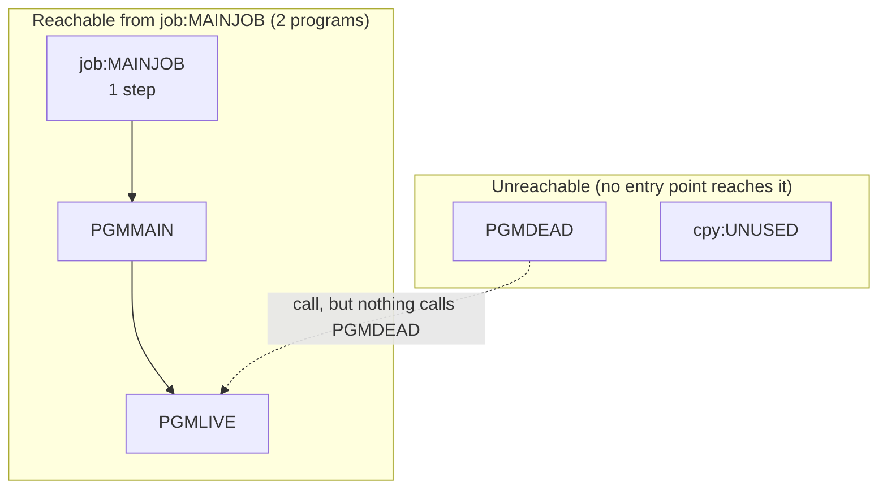

# 02. Coupling

Fact tables are in `02a-edge-tables.md`. This file is the argument.

## The short version

There are four edges in the whole tree and not one of them is a data edge. That is the finding.
A system whose migration risk lives in shared VSAM files and undocumented record layouts has
none of that here, because this tree contains **no dataset of any kind** — no DD statement beyond
the EXEC card (`app/jcl/MAINJOB.jcl:2`), no FILE SECTION in any of the three programs
(`app/cbl/PGMMAIN.cbl:3`, `app/cbl/PGMLIVE.cbl:3`, `app/cbl/PGMDEAD.cbl:3`; each goes
IDENTIFICATION DIVISION straight to PROCEDURE DIVISION with nothing between).

The honest reading is that this is a **fragment or a scaffold**, not the nightly batch cycle the
scoping answer named. Everything downstream in this assessment is scoped to what is on disk, and
what is on disk cannot be the system the client is worried about. See Open Questions in
`00-summary.md`.

## The coupling patterns that constrain sequence

| # | Pattern | What it constrains | Evidence | Confidence |
|---|---|---|---|---|
| 1 | One call chain, two links deep: `job:MAINJOB` → `step:MAINJOB.S1` → `PGMMAIN` → `PGMLIVE` | The entire sequence. There is one entry point and one leaf. Nothing can be ported out of order because there is only one order. | `app/jcl/MAINJOB.jcl:2`, `app/cbl/PGMMAIN.cbl:4` | high |
| 2 | `PGMLIVE` has two static callers in the tree, but only one of them is reachable | `PGMLIVE` cannot be deleted or signature-changed on the evidence of `PGMMAIN` alone until `PGMDEAD` is resolved. | `app/cbl/PGMMAIN.cbl:4`, `app/cbl/PGMDEAD.cbl:4` | high |
| 3 | No data coupling, no contract coupling, no temporal coupling | There is no shared-file dependency to sequence around, and no scheduler to honour. Also: no behavioural oracle. See `06-test-strategy.md`. | `analysis` (`edge_counts` = 3 call, 1 include; `data_hubs` empty) | high |

### 1. Call coupling is the only coupling

`analysis.fan_in` records exactly one entry, `PGMLIVE: 1`, and `analysis.fan_out` exactly one,
`PGMMAIN: 1`, both computed over the two reachable programs (`analysis.structure_basis`:
"programs reachable from an entry point (2 of 3)"). There is nothing to untangle.

### 2. `PGMLIVE` is the only shared unit, and its second caller is dead

`PGMMAIN` calls `PGMLIVE` (`app/cbl/PGMMAIN.cbl:4`) and so does `PGMDEAD`
(`app/cbl/PGMDEAD.cbl:4`). `PGMDEAD` has no caller of its own, so the extractor put it in
`dead_code_candidates.unreachable` (`analysis`). The fan-in figure of 1 is therefore correct
*for the reachable graph* and misleading *for the file tree*: there are two `CALL 'PGMLIVE'`
statements on disk.

This matters in one specific way. If the port changes `PGMLIVE`'s interface, a grep for its
callers finds two sites, and a reviewer who does not know `PGMDEAD` is unreachable will either
port `PGMDEAD` needlessly or, worse, take the existence of two callers as evidence that
`PGMLIVE` is a shared service worth preserving as one. It is not; it is a `GOBACK`
(`app/cbl/PGMLIVE.cbl:4`). Resolve `PGMDEAD` (see `05-dead-code.md`) *before* touching
`PGMLIVE`, not after.

### 3. What is not here

- **Data coupling.** None. `analysis.data_hubs` is empty and there are no `ds:` nodes in
  `graph.json`. The usual number-one cause of a broken migration plan does not apply to this tree.
- **Contract coupling.** None, for the same reason. No program writes a record another reads.
- **Temporal coupling.** None modelled. One job, one step (`app/jcl/MAINJOB.jcl:1-2`). The
  extractor warns that no scheduler artifact was parsed (`analysis.warnings`), so any ordering
  that exists between this job and other jobs is invisible — but there are no other jobs on disk
  either.

## Cluster graph

At cluster level there is one cluster, plus one orphan.

## Structure

| Property | Value | Evidence | Confidence |
|---|---|---|---|
| Strongly connected components | none | `analysis.sccs` = `[]` | high |
| Self-recursive programs | none | `analysis.self_recursive` = `[]` | high |
| Articulation points | none | `analysis.articulation_points` = `[]` | high |
| God modules | none | `analysis.god_modules` = `[]` | high |
| Data hubs | none | `analysis.data_hubs` = `[]` | high |

No SCC means no unit is forced to move with another by a cycle. No articulation point means the
seed plan has no natural cut line — which is consistent with a single wave.

## The honest boundary

| Limit | Effect here | Evidence | Confidence |
|---|---|---|---|
| Computed calls | **None.** `analysis.unresolved_dynamic` is empty, so the reachability result is not undermined by a dynamic target. This is the one thing that makes the `PGMDEAD` dead-code claim unusually strong for a static analysis. | `analysis` | high |
| Embedded JCL in COBOL literals | **None found.** `analysis.embedded_jcl` is empty. No program submits work through the internal reader. | `analysis` | high |
| Runtime-named programs | **None.** `analysis.runtime_named` is empty. No IMS region or TSO RUN PROGRAM card names a program the graph cannot see. | `analysis` | high |
| No scheduler artifact parsed | The extractor warns that one JCL job exists with no scheduler to order it. Whether `MAINJOB` is triggered nightly, and what runs before and after it, is unknown from the tree. | `analysis.warnings` | high |
| No git dates | `meta.git_dates` is `false`. The dormancy rule was not applied at all, so "not dormant" here means "not measured". | `analysis.warnings` | high |
| Files not parsed | **None.** `unparsed` is empty and `meta.files_seen` accounts for all five files on disk (3 cobol, 1 copy, 1 jcl). | `modernization-assessment/graph.json:155` (`unparsed` field), `meta.files_seen` | high |

The extractor saw everything that is here. The risk is not what it missed inside the tree; the
risk is what is outside the tree.
