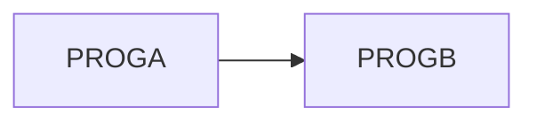

# 02 Coupling

The tree holds two COBOL programs and no JCL, copybooks, datasets or scheduler (`modernization-assessment/graph.json:24`). The only edge is one static call.

## Coupling patterns

| Pattern | Finding | Confidence | Evidence |
|---|---|---|---|
| Call | PROGA calls PROGB with a literal target. Resolved, high confidence. | high | app/cbl/PROGA.cbl:6 |
| Data | None. Neither program names a file, table or dataset. | high | app/cbl/PROGA.cbl:3, app/cbl/PROGB.cbl:3 |
| Contract | None. No shared record layout, because no data edges exist. | high | analysis (`data_hubs` is empty) |
| Temporal | Unknown. The nightly order lives in a scheduler or JCL that is not in the tree. | low | inference |

## Cluster graph

## Structure

| Item | Result | Confidence | Evidence |
|---|---|---|---|
| Strongly connected components | None | high | analysis (`sccs`) |
| God modules | None. PROGA is 7 lines, PROGB is 4. | high | app/cbl/PROGA.cbl:7, app/cbl/PROGB.cbl:4 |
| Articulation points | None | high | analysis (`articulation_points`) |
| Computed calls | None | high | analysis (`unresolved_dynamic`) |

PROGB's body is only `GOBACK` (app/cbl/PROGB.cbl:4). It does no work in this tree. PROGA displays `CALL FAILED IF WE GET HERE` on line 5, before the call on line 6. That text prints every time PROGA runs, whatever the call does. It reads like a planted test message (inference). A port must reproduce it or record the change in the Deviation Register.

## The honest boundary

The graph is correct for what it holds, and it is almost empty. The user named "the nightly batch cycle" as the must-not-break item. No file in the tree maps to a batch cycle: no job, step, scheduler or entry point. Everything about the cycle's order, datasets and schedule is outside the evidence (inference).
