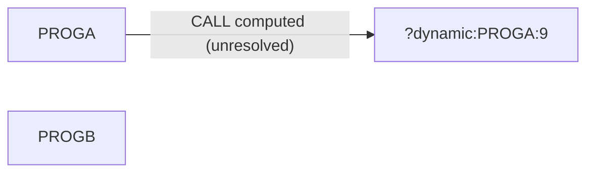

# 02 Coupling

The tree holds two COBOL programs, no copybooks, no JCL, no scheduler and no datasets (`modernization-assessment/graph.json:24`). The full edge list is in `02a-edge-tables.md`.

## Patterns that constrain the sequence

| Pattern | Finding | Confidence | Evidence |
|---|---|---|---|
| Call coupling | One edge. PROGA does `CALL WS-PGM-NAME`. The target is computed, so the extractor could not resolve it. | low | `app/cbl/PROGA.cbl:9` |
| Where the name comes from | `WS-PGM-NAME` is set by `ACCEPT` at run time, so the callee is chosen by an operator, a job card or stdin. It is not a literal or VALUE clause. | medium | `app/cbl/PROGA.cbl:8` |
| Data, contract, temporal coupling | None visible. No dataset, copybook or scheduler is in the tree. This is a gap in what was supplied, not proof the system has none. | inference | `modernization-assessment/graph.json:24` |

## Clusters

PROGB has no edge in the graph. It may be the target of PROGA's computed call (inference, `app/cbl/PROGA.cbl:9`).

## Structure

- Strongly connected components: none (`analysis.sccs`).
- God modules: none (`analysis.god_modules`).
- Articulation points: none (`analysis.articulation_points`). No natural wave boundary exists.

## The honest boundary

The computed call at `app/cbl/PROGA.cbl:9` can reach any program that can be loaded at run time, including programs not in this tree. Until the client supplies the possible values of `WS-PGM-NAME`, the real dependency set of PROGA is unknown. With only one open edge, the cartographer agent was not needed.
