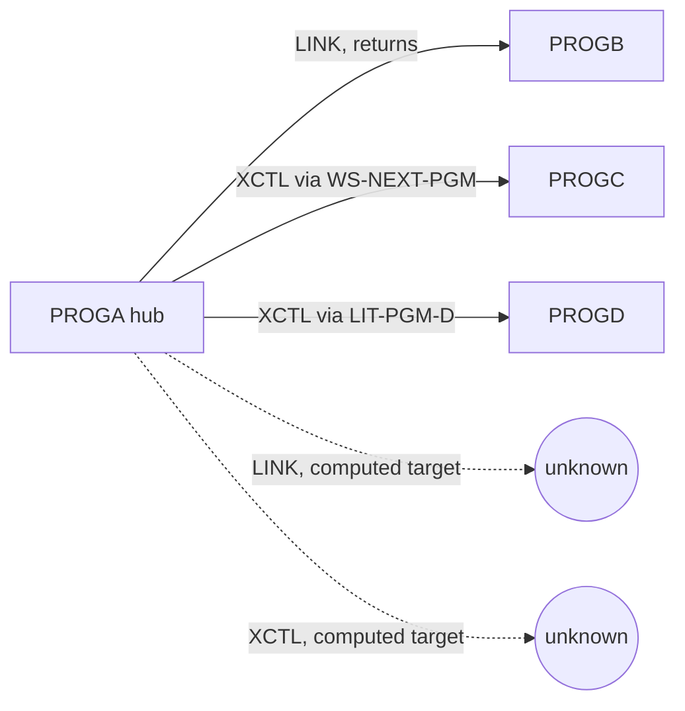

# 02 Coupling

Fact tables are in `02a-edge-tables.md`. This file is the argument.

## Scale

Four COBOL programs, 38 lines, five call edges, no data edges, no copybooks, no JCL. `graph.json` has no dataset or contract node (`analysis` field `data_hubs` is empty, `edge_counts` is call only). Coupling here is call coupling and nothing else.

## Patterns that constrain the sequence

| # | Pattern | Evidence | Confidence |
|---|---|---|---|
| 1 | PROGA is a hub with fan-out 3. Everything else hangs off it. | `app/cbl/PROGA.cbl:12`, `app/cbl/PROGA.cbl:20`, `app/cbl/PROGA.cbl:23` | high |
| 2 | Two of PROGA's targets are reached only through a variable (`WS-NEXT-PGM`, `LIT-PGM-D`). The extractor resolved both from VALUE and MOVE literals. | `app/cbl/PROGA.cbl:5`, `app/cbl/PROGA.cbl:19` | medium for PROGC, high for PROGD |
| 3 | XCTL never returns. PROGC and PROGD take over the task from PROGA, so they are a continuation of PROGA's logic, not services it calls. The extractor models LINK and XCTL both as `call` and does not model control flow (`meta.limits`). | `app/cbl/PROGA.cbl:20`, `app/cbl/PROGA.cbl:23` | high |

Coupling note on pattern 3, labeled inference: because PROGA ends in an XCTL to PROGD after an XCTL to PROGC, the second XCTL at line 23 is unreachable in straight-line flow. Line 20 never returns. Either the code is dead after line 20 or a condition was removed. inference, nothing in the file branches. A human must say which.

## Cluster graph

At this size a program-level graph is the cluster graph.

## Strongly connected components

None (`analysis` field `sccs` is empty). Nothing forces programs to move together on a cycle. The facade argument below still applies.

## God modules

None (`analysis` field `god_modules` is empty). PROGA is 26 lines (`app/cbl/PROGA.cbl:26`).

## Articulation points

PROGA (`analysis` field `articulation_points`). It is trivially so, as the only caller of three leaves. It is the natural boundary: put PROGA behind a facade and its three targets can be replaced one at a time. inference.

## The honest boundary: computed calls

| Site | What the code shows | Evidence | Confidence |
|---|---|---|---|
| LINK `WS-ANY-PGM` | The target is `DFHCOMMAREA`, a caller-supplied 8 byte field. It can name any program on the region. The extractor could resolve nothing. | `app/cbl/PROGA.cbl:15`, `app/cbl/PROGA.cbl:16` | low |
| XCTL `WS-NEXT-PGM` | One literal, `'PROGC'`, is moved to it. The edge note says other literals may exist. In this file there is only one MOVE. | `app/cbl/PROGA.cbl:19`, `app/cbl/PROGA.cbl:20` | medium |

The first is the real finding. The commarea is the contract between PROGA and its caller, and that caller is not in the tree. Every program on the CICS region is a possible target, so the set of programs PROGA can run is open. In a refactor to services this is a routing table that does not yet exist. The calling transaction and the CSD are the way to close it. Until then, no program in the tree can be called dead, and none outside the tree can be called safe to change.
