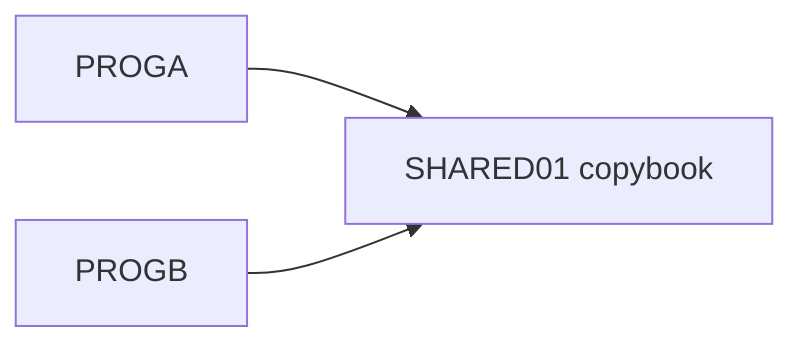

# 02 Coupling

The tree holds two programs and one copybook. The extractor found two edges, both `include` (`analysis`: `edge_counts`).

## The pattern that matters: one layout, two programs

| Pattern | What it is | Evidence | Confidence |
|---|---|---|---|
| Shared copybook | PROGA copies `SHARED01` | `app/cbl/PROGA.cbl:5` | high |
| Shared copybook | PROGB copies `SHARED01` | `app/cbl/PROGB.cbl:5` | high |
| Layout content | `SH-CUST-ID PIC 9(9)` and `SH-BALANCE PIC S9(9)V99 COMP-3` | `app/cpy/SHARED01.cpy:2`, `app/cpy/SHARED01.cpy:3` | high |

Consequences for sequence:

- `SHARED01` has two users, so it cannot be ported or changed in isolation. Whichever program moves first fixes the target layout for the other. Both move in the same wave, or the copybook stays a shared contract until both are done. This is inference from the two includes; no dataset or call edge ties the programs together.
- `SH-BALANCE` is packed decimal (`app/cpy/SHARED01.cpy:3`). It is money. Target type must be decimal with zero tolerance. A float port is a defect. See `06-test-strategy.md`.
- Each program only moves a literal into `SH-CUST-ID` (`app/cbl/PROGA.cbl:7`, `app/cbl/PROGB.cbl:7`). Neither reads or writes a file. There is no data coupling and no contract edge in `graph.json`. Whether the real system passes this record between jobs is not visible here. Inference.

## Not found

| Coupling kind | Result | Evidence |
|---|---|---|
| Call | None. No `CALL`, `LINK` or `XCTL` | `analysis`: `edge_counts` has only `include` |
| Data / contract | None. No dataset, VSAM or DB2 edge, so no `data_hubs` | `analysis`: `data_hubs` is empty |
| Temporal | None. No JCL, scheduler or wrapper in the tree | `modernization-assessment/graph.json:30`, `modernization-assessment/graph.json:27`, `modernization-assessment/graph.json:32` (files_seen: jcl, controlm, shell all 0) |
| Computed calls | None | `analysis`: `unresolved_dynamic` is empty |

## Structure

- Strongly connected components: none (`analysis`: `sccs` empty).
- God modules: none. Articulation points: none, so there is no natural wave boundary here.
- Fan-in and fan-out are empty because no entry points exist (`analysis`: `structure_basis` is "all programs (no entry points were found)").

## Cluster view

## The honest boundary

This tree is a fragment. The must-not-break item, "the nightly batch cycle", maps to no unit in it: there is no JCL job, scheduler job or wrapper. Everything about order, datasets and the cycle lives in files the client has not supplied. Coupling in the real system is unknown, not low.
