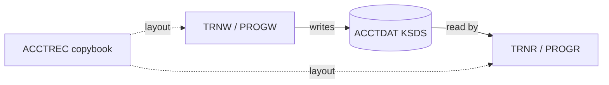

# Coupling

The tree is two CICS programs, one copybook and one CSD. The edge tables are in `02a-edge-tables.md`.

## Patterns that constrain the sequence

| Pattern | Finding | Confidence | Evidence |
|---|---|---|---|
| Contract coupling | PROGW writes ACCTDAT and PROGR reads it. Both COPY ACCTREC, so the layout is shared. The edge is high, which means a shared layout, not a proven-equal one. | high | app/cbl/PROGW.cbl:7, app/cbl/PROGR.cbl:7, app/cbl/PROGW.cbl:5, app/cbl/PROGR.cbl:5 |
| Data coupling | One VSAM KSDS, `SPARQ.TEST.ACCTDAT.KSDS`, has one writer and one reader. It is the only articulation point in the graph. | high | app/csd/DEMO.CSD:1, app/csd/DEMO.CSD:2 |
| Packed-decimal layout | ACCT-BAL is `S9(9)V99 COMP-3`. A port that reads it as text or float breaks silently. | medium (the arithmetic is not in the tree, so sensitivity is inference) | app/cpy/ACCTREC.cpy:3 |
| Temporal coupling | None found. There is no JCL, Control-M or shell wrapper in the tree. | high that none is parsed; the real scheduler is unknown | modernization-assessment/graph.json:25 |

## Clusters

## Structure

- Strongly connected components: none. Evidence: `analysis.sccs` is empty.
- God modules: none. Evidence: `analysis.god_modules` is empty. Both programs are 11 lines (app/cbl/PROGR.cbl:11, app/cbl/PROGW.cbl:11).
- Articulation points: the ACCTDAT dataset (`analysis.articulation_points`). It is the natural boundary between the two waves.
- Computed calls: none. Evidence: `analysis.unresolved_dynamic` is empty.

## The honest boundary

The extractor sees only what is in the tree. The file is named `SPARQ.TEST.ACCTDAT.KSDS`, so it may be a test definition, not production (app/csd/DEMO.CSD:2, inference). There is no sign of any other program, batch job or transaction that touches ACCTDAT. In a real CICS region, a batch job that reads or loads the same KSDS is common. If one exists, it is a third user of the contract and was not assessed. This is the first Open Question.
