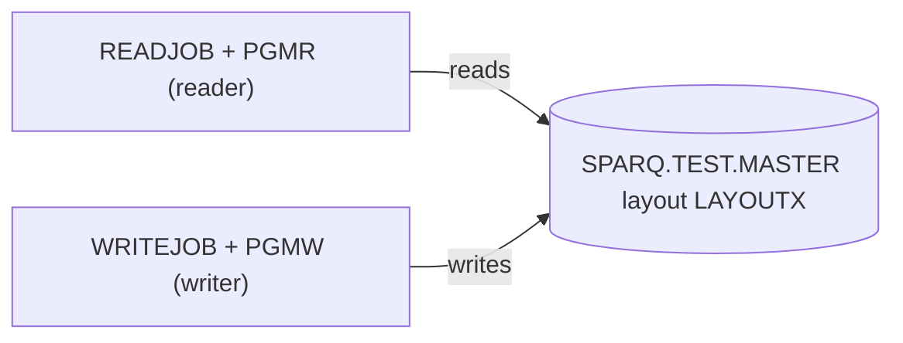

# 02 Coupling

The tree is small: 2 programs, 2 jobs, 1 copybook, 1 dataset (`modernization-assessment/graph.json:35`). Every edge is in `02a-edge-tables.md`. This file is the argument.

## The patterns that constrain the sequence

| # | Pattern | Why it constrains the sequence | Confidence | Evidence |
|---|---|---|---|---|
| 1 | Contract coupling through `SPARQ.TEST.MASTER`. PGMW writes it, PGMR reads it, both through copybook LAYOUTX. | The record layout is the only interface between the two programs. The extractor rates it `high`, which means shared layout, not proven equal. | high | `app/cbl/PGMW.cbl:11`, `app/cbl/PGMR.cbl:11`, `app/jcl/WRITEJOB.jcl:3`, `app/jcl/READJOB.jcl:3` |
| 2 | The layout holds a packed-decimal field, `LR-AMT PIC S9(7)V99 COMP-3`. | Any refactor that decodes it into a float changes money values. It needs a decimal type and zero tolerance. | high | `app/cpy/LAYOUTX.cpy:3` |
| 3 | The copybook describes a 15-byte record (10 bytes of key, 9 digits packed into 5 bytes) but the writer's DD declares `RECFM=FB,LRECL=80`. The extractor does not compare them. | A port that builds records from the copybook gets 15 bytes and one that follows the JCL gets 80. The two readings of "the file" differ. Which is right is an open question. | medium | `app/cpy/LAYOUTX.cpy:2`, `app/cpy/LAYOUTX.cpy:3`, `app/jcl/WRITEJOB.jcl:4`, `modernization-assessment/graph.json:20` |
| 4 | Temporal coupling that nothing enforces. PGMR is only meaningful after PGMW has created the file, but no scheduler artifact is in the tree and no condition ties the two jobs. | Run order across the jobs is unknown. The "nightly batch cycle" cannot be tied to a unit in this tree. | medium (inference) | `modernization-assessment/graph.json:383`, inference |

## Strongly connected components

None (`analysis.sccs` is empty, `modernization-assessment/graph.json:310`). No call cycles. Neither program calls the other. Both are reached only through a JCL step (`app/jcl/READJOB.jcl:2`, `app/jcl/WRITEJOB.jcl:2`).

## God modules

None (`analysis.god_modules` is empty, `modernization-assessment/graph.json:309`). Each program is 16 lines (`01-inventory.md`).

## Articulation points

One: the dataset `ds:SPARQ.TEST.MASTER` (`analysis.articulation_points`, `modernization-assessment/graph.json:312`). It is the natural wave boundary. The two waves are cut exactly there: the reader on one side, the writer on the other.

## Cluster graph

## The honest boundary

- Computed calls: none (`analysis.unresolved_dynamic` is empty, `modernization-assessment/graph.json:302`). Nothing the extractor gave up on.
- Embedded JCL in COBOL: none noticed (`modernization-assessment/graph.json:303`).
- No scheduler, so no temporal edges exist. The extractor warns that cross-job order is unknown (`modernization-assessment/graph.json:383`).
- Nothing was skipped as unparsed (`modernization-assessment/graph.json:286`). A shell wrapper, a scheduler export or a database outside this tree would not show up as unparsed either. The extractor only lists files it recognizes (`modernization-assessment/graph.json:24`).
