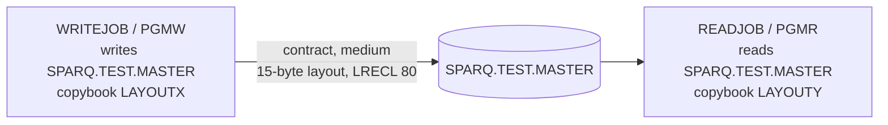

# 02 Coupling

The tree is small: two COBOL programs, two JCL jobs, two copybooks, one dataset. All nine edges are in `modernization-assessment/02a-edge-tables.md`. This file is the argument.

## The pattern that constrains the sequence

### 1. One undocumented contract on `SPARQ.TEST.MASTER` (the only coupling that matters)

PGMW writes the dataset and PGMR reads it. There is no call between the two programs. The only link is the file.

| Finding | Confidence | Evidence |
|---|---|---|
| PGMW writes `SPARQ.TEST.MASTER` through DD `OUTFILE`, `DISP=(NEW,CATLG,DELETE)`, `LRECL=80`, `RECFM=FB` | high | `app/jcl/WRITEJOB.jcl:3`, `app/jcl/WRITEJOB.jcl:4`, `app/cbl/PGMW.cbl:13` |
| PGMR reads the same dataset through DD `INFILE`, `DISP=SHR`. No `DCB` is coded on the reader DD | high | `app/jcl/READJOB.jcl:3`, `app/cbl/PGMR.cbl:13` |
| The writer record comes from `LAYOUTX`: `LR-KEY X(10)`, `LR-AMT S9(7)V99 COMP-3` | high | `app/cpy/LAYOUTX.cpy:2`, `app/cpy/LAYOUTX.cpy:3`, `app/cbl/PGMW.cbl:11` |
| The reader record comes from `LAYOUTY`: `LY-ID X(10)`, `LY-VALUE S9(7)V99 COMP-3` | high | `app/cpy/LAYOUTY.cpy:2`, `app/cpy/LAYOUTY.cpy:3`, `app/cbl/PGMR.cbl:11` |

**Why the extractor rated the edge `medium`.** The writer and reader COPY two different copybooks, so the extractor cannot call the layout shared (`analysis.edge_counts`, edge `PGMW -> PGMR`, kind `contract`; `app/cbl/PGMW.cbl:11`, `app/cbl/PGMR.cbl:11`).

**What the source shows.** I compared the two copybooks field by field (inference, read by hand):

| Offset | Writer field (`LAYOUTX`) | Reader field (`LAYOUTY`) | Match |
|---|---|---|---|
| 0, 10 bytes | `LR-KEY PIC X(10)` | `LY-ID PIC X(10)` | same picture, different name |
| 10, 5 bytes | `LR-AMT PIC S9(7)V99 COMP-3` | `LY-VALUE PIC S9(7)V99 COMP-3` | same picture, different name |

The two records are byte-compatible today: 15 bytes each, packed decimal with a sign nibble. The mismatch is in the names only. Confidence in this reading: medium. The two copybooks are three lines each, so the reading is easy to check. DCB, LRECL and RECFM are not compared by the extractor (`meta.limits`).

**Why this still constrains the port.** The compatibility is accidental. Nothing makes the two copybooks the same, and either one can drift. A refactor that "tidies" one copybook, or generates a typed record for each side, can break the other side without any compiler or JCL error. Under a refactor target, the first thing to do is state the layout once, in one place, with the dataset record length, and have both sides use it. Until then, the reader depends on the writer's layout by convention.

**A second, smaller mismatch.** The writer DD says `LRECL=80` (`app/jcl/WRITEJOB.jcl:4`). Neither FD declares a record length, and the record in each copybook is 15 bytes (`app/cbl/PGMW.cbl:10`, `app/cbl/PGMR.cbl:10`). The file is therefore probably stored as 80 byte records with 65 bytes of padding after the 15 byte layout. This is inference. It shows what the oracle must pin down: the contract is the 80 byte record, not the 15 byte copybook. The reader DD has no DCB, so it takes its attributes from the catalog entry the writer created (`app/jcl/READJOB.jcl:3`). That is a third place where the contract lives, and a port must reproduce it.

### 2. The writer does not initialise its record (inference, high concern)

PGMW opens the output, executes `WRITE LAYOUT-REC`, and closes. No statement moves a value into `LR-KEY` or `LR-AMT` (`app/cbl/PGMW.cbl:13`, `app/cbl/PGMW.cbl:14`, `app/cbl/PGMW.cbl:15`). In the source as given, the bytes written are whatever the runtime leaves in the record area. A `COMP-3` field with no initial value may hold invalid packed data. This is a test fixture sized program, not a real posting program, so I cannot say whether the real cycle has more logic that is not in this tree. It matters for two reasons:

- The port cannot be checked against "what the code says", because the code says nothing. It must be checked against a captured output file.
- A characterization test built from this source would encode undefined behavior.

### 3. Temporal coupling is real but unrecorded

The reader depends on the writer: `DISP=SHR` on a dataset that `WRITEJOB` creates with `DISP=(NEW,CATLG,DELETE)` (`app/jcl/READJOB.jcl:3`, `app/jcl/WRITEJOB.jcl:3`). `WRITEJOB` must run before `READJOB`. Two things follow:

- No scheduler artifact is in the tree, so the extractor drew no temporal edge (`analysis.warnings`, `analysis.unscheduled_jobs` is empty because no scheduler was parsed). The order is deduced from the data edge, and it is not recorded anywhere I could cite as a rule.
- `DISP=(NEW,CATLG,DELETE)` fails if the dataset already exists. Something outside this tree must delete the previous generation before `WRITEJOB` runs, or the dataset is a GDG with a different name, or the job abends every night after the first (inference). I cannot tell which. See Open Questions.

## Strongly connected components

None (`analysis.sccs` is empty). No wave is forced by a cycle.

## God modules

None (`analysis.god_modules` is empty; there are no program to program calls, `analysis.fan_in` is empty). A graph this small makes the decile test meaningless. Do not read it as "healthy".

## Articulation points

One: `ds:SPARQ.TEST.MASTER` (`analysis.articulation_points`). It is the only thing that joins the two job families, so it is the natural wave boundary. The boundary test for a wave is an assertion on this file.

## Cluster diagram

## The honest boundary

| Item | Value | Evidence |
|---|---|---|
| Computed calls the extractor could not resolve | 0 | `analysis.unresolved_dynamic` is empty |
| JCL text inside COBOL | none found | `analysis.embedded_jcl` is empty |
| Programs started by name from PARM or cards | none found | `analysis.runtime_named` is empty |
| Files not parsed | none | analysis: `unparsed` is empty in `modernization-assessment/graph.json` (inference) |
| Scheduler | **absent**: no Control-M XML or wrapper script in the tree | `analysis.warnings` |
| Anything outside `app/` | not present in the working directory | inference, from a listing of the tree root |

What this means: the call graph is complete for the files given. It says nothing about the nightly cycle as a whole, because the cycle's scheduler, its other jobs, and any steps that clean up `SPARQ.TEST.MASTER` are not in the tree.
