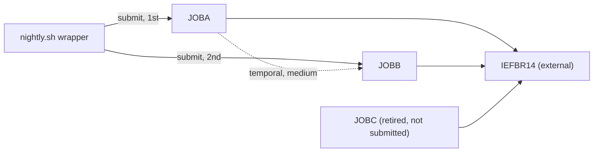

# 02 Coupling

The tree is small: 3 JCL jobs, 1 shell wrapper, 0 programs, 0 copybooks, 0 datasets (`analysis`: `node_counts`). The tables are in `modernization-assessment/02a-edge-tables.md`. This file holds the argument.

## Patterns that constrain the migration

| # | Pattern | Why it constrains the sequence | Confidence | Evidence |
|---|---|---|---|---|
| 1 | **Temporal coupling lives only in the shell wrapper.** The wrapper submits JOBA, then JOBB. Nothing in the JCL says JOBB follows JOBA. | A port that moves JOBs into a scheduler without carrying the wrapper's order loses the only ordering rule. The extractor rates the edge medium because it comes from line order in a script. | medium | `scripts/nightly.sh:4`, `scripts/nightly.sh:5` |
| 2 | **`set -e` makes JOBB conditional on the submit of JOBA.** If the submit command for JOBA returns non-zero, JOBB is never submitted. | The failure semantics are part of the behavior to preserve. What `submit` returns (job accepted, or job finished clean) is not shown. | low (inference) | `scripts/nightly.sh:3`, `scripts/nightly.sh:4` |
| 3 | **A retired job still exists as an entry point.** JOBC is marked retired and its submit is commented out, but the JCL file remains, so the extractor treats it as live. | It inflates the entry-point count and the wave. It should leave by decision, not by port. | high | `scripts/nightly.sh:2`, `scripts/nightly.sh:6`, `jcl/JOBC.jcl:1` |

There is no data coupling and no contract coupling: the extractor found no dataset node and no read or write edge, and every step runs only IEFBR14 (`jcl/JOBA.jcl:2`, `jcl/JOBB.jcl:2`, `jcl/JOBC.jcl:2`). That is a fact about this tree. It is not evidence that the production cycle has none (inference, see the Open Questions in `modernization-assessment/00-summary.md`).

## Cluster graph

## Structure

| Fact | Result | Evidence |
|---|---|---|
| Strongly connected components | none | `analysis`: `sccs` |
| God modules | none, there are no programs | `analysis`: `god_modules` |
| Articulation points | none | `analysis`: `articulation_points` |
| Computed calls | none | `analysis`: `unresolved_dynamic` |

## The honest boundary

No computed calls exist, but that is because there is almost no code. The extractor does not read `submit` (it is not a known command; what it does is inference), does not model JCL return codes, and reads only wrappers that name JCL files (`meta.limits`). IEFBR14 is not in the tree (`ext:IEFBR14`). Anything the real nightly cycle does beyond allocating or deleting datasets with IEFBR14 is outside what was scanned.
