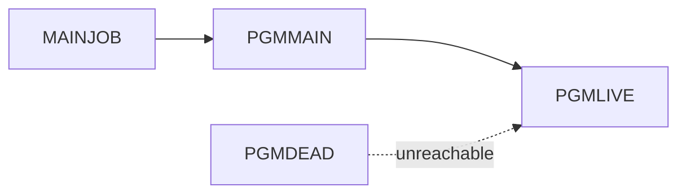

# 02 Coupling

The tree is five source files. Generated edge tables are in `02a-edge-tables.md`.

## Patterns that constrain the sequence

| Pattern | Finding | Confidence | Evidence |
|---|---|---|---|
| Call coupling | `MAINJOB` step `S1` runs `PGMMAIN`, which calls `PGMLIVE`. This is the only live path. | high | `app/jcl/MAINJOB.jcl:2`, `app/cbl/PGMMAIN.cbl:4` |
| Shared callee | `PGMLIVE` has two callers. `PGMDEAD` is unreachable, so its call does not couple `PGMLIVE` to anything live. | high | `app/cbl/PGMDEAD.cbl:4` |
| Data, contract, temporal | None found. No file, DB2, VSAM or scheduler reference appears in any source. This is absence in five files, not proof for the real system. | medium | inference |

## Clusters

## Structure

- Strongly connected components: none. `analysis.sccs` is empty.
- God modules: none. `analysis.god_modules` is empty.
- Articulation points: none. `analysis.articulation_points` is empty.
- Computed calls: none. `analysis.unresolved_dynamic` is empty, so the reachability result is not weakened by a hidden call.

## Honest boundary

- No scheduler export was parsed. Order across jobs is unknown (`analysis.warnings`). With one job, ordering matters only against jobs outside this tree.
- `PGMMAIN` and `PGMLIVE` hold no I/O and no logic (`app/cbl/PGMLIVE.cbl:4`). This looks like a stub or an excerpt, so inference: the real nightly cycle is larger than what was supplied.
