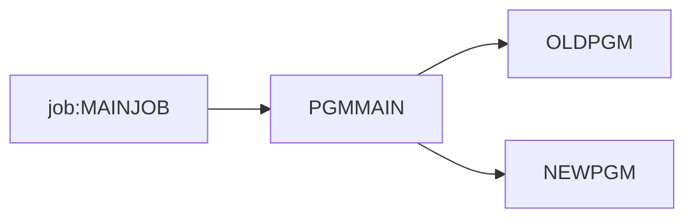

# Coupling

The tree is very small: one JCL job, one batch program and two subprograms. The coupling is a single
chain, so there is little to argue about. Everything below is read from `graph.json`.

## Patterns that constrain the sequence

| # | Pattern | Evidence | Confidence |
|---|---|---|---|
| 1 | Chain: `job:MAINJOB` runs step S1, which runs `PGMMAIN`, which calls `OLDPGM` and `NEWPGM`. Nothing else enters the tree, so all four units share one entry point and must be tested through it. | app/jcl/MAINJOB.jcl:2, app/cbl/PGMMAIN.cbl:4, app/cbl/PGMMAIN.cbl:5 | high |
| 2 | `PGMMAIN` is the only articulation point. Cutting it separates both subprograms from the job. | analysis.articulation_points (`PGMMAIN`) | high |
| 3 | There is no data coupling, contract coupling or temporal coupling in the tree: no dataset, copybook or DD is named. This is an absence in the tree, not proof that the batch cycle shares nothing. | analysis.data_hubs (empty), meta.files_seen (copy: 0) | medium |

## Clusters

The graph is at program level because the whole system is four units.

## Strongly connected components

None (`analysis.sccs` is empty). No wave can split one.

## God modules

None (`analysis.god_modules` is empty). The biggest unit is 6 lines (app/cbl/PGMMAIN.cbl:1).

## Articulation points

`PGMMAIN` (analysis.articulation_points). It is the natural boundary for a facade, but with a single wave
there is no boundary to cut.

## The honest boundary

- **Computed calls:** none (`analysis.unresolved_dynamic` is empty). Both CALLs are literals
  (app/cbl/PGMMAIN.cbl:4, app/cbl/PGMMAIN.cbl:5).
- **Scheduler:** no scheduler artifact was parsed (analysis.warnings). The order of jobs across jobs is
  unknown. `job:MAINJOB` may be one of many jobs in the nightly cycle, and this tree may be a fragment of
  it. That is inference.
- **Nothing in the tree is a datastore.** Every program body is a GOBACK plus the CALLs
  (app/cbl/OLDPGM.cbl:4, app/cbl/NEWPGM.cbl:4). The real behavior is either elsewhere or absent. The client
  must say which. That is inference.
