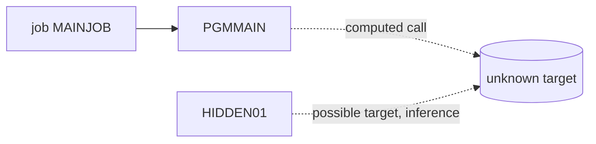

# 02 Coupling

The tree is small: 2 COBOL programs and 1 JCL job (`modernization-assessment/graph.json`, `meta.files_seen`). The edge tables are in `02a-edge-tables.md`. This file is the argument.

## Patterns that constrain the sequence

| Pattern | Finding | Confidence | Evidence |
|---|---|---|---|
| Computed call | PGMMAIN reads a program name from input and calls it. Whatever it calls is not in the graph. | low | `app/cbl/PGMMAIN.cbl:8`, `app/cbl/PGMMAIN.cbl:9` |
| Job runs one program | MAINJOB step S1 runs PGMMAIN. This is the only static path into application code. | high | `app/jcl/MAINJOB.jcl:2` |
| No data coupling | No dataset, DD or table appears in the tree, so there are no data or contract edges. This describes the files given, not the system. | medium | `analysis` field `data_hubs` (empty) |
| No temporal coupling known | No scheduler artifact was parsed. The order this job runs in relative to other jobs is unknown. | low | `analysis` field `warnings` |

The computed call is the one that matters. PGMMAIN does `ACCEPT WS-PGM-NAME` and then `CALL WS-PGM-NAME`. The target comes from outside the source: SYSIN, a PARM, or a caller. The step has no SYSIN or PARM in the JCL we have (`app/jcl/MAINJOB.jcl:2`), so the value is `inference`: it is unknown from this tree, and HIDDEN01 is the one candidate in the tree (`app/cbl/HIDDEN01.cbl:2`).

## Cluster graph

## Strongly connected components

None (`analysis` field `sccs`). No wave is at risk of splitting one.

## God modules

None (`analysis` field `god_modules`). PGMMAIN is 10 lines (`app/cbl/PGMMAIN.cbl:10`).

## Articulation points

None (`analysis` field `articulation_points`). With one wave there is no boundary to cut.

## The honest boundary

One computed call is unresolved (`analysis` field `unresolved_dynamic`, `app/cbl/PGMMAIN.cbl:9`). The extractor resolves a variable target only from VALUE clauses and literal MOVEs in the same program (`meta.limits`). PGMMAIN has neither (`app/cbl/PGMMAIN.cbl:5`), so nothing was resolved. Consequences:

1. The reachable set is a lower bound. Real run-time reach may include programs this tree does not contain, as well as HIDDEN01.
2. Everything the called program does is outside this assessment: its files, its tables, its own calls.
3. A port that makes the call static, or drops it, changes behavior. The port must keep run-time dispatch, or the client must supply the full list of names that arrive.

Edges the extractor settled: 2 high-confidence call edges and 1 include edge (`02a-edge-tables.md`). Fewer than 20 edges are open, so the dependency-cartographer was not used.
