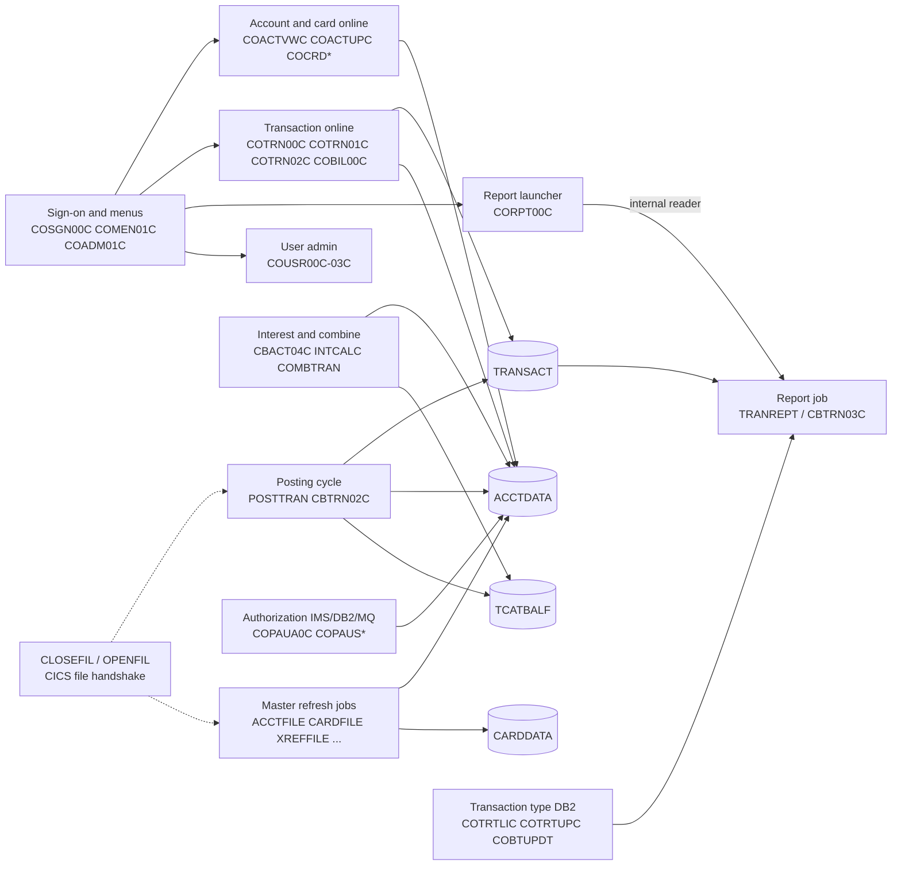

# 02 Coupling

Target state: refactor. Must not break: daily transaction posting, the account and card master refresh, the transaction report. Telemetry: none. The full edge list is in `02a-edge-tables.md`. This file is the argument.

## The three patterns that constrain the sequence

### 1. Two VSAM files carry the whole system, and batch and online both write them

`ACCTDATA` and `TRANSACT` are the two largest data hubs. ACCTDATA has 4 writers and 11 readers. TRANSACT has 3 writers and 11 readers (`analysis` field `data_hubs`). The batch posting program CBTRN02C updates the account, the category balance and the transaction file (`app/cbl/CBTRN02C.cbl:403`, `app/cbl/CBTRN02C.cbl:51`, `app/cbl/CBTRN02C.cbl:34`). The online programs COACTUPC, COBIL00C and COTRN02C write the same files under CICS (`app/cbl/COACTUPC.cbl:573`, `app/cbl/COBIL00C.cbl:41`, `app/cbl/COTRN02C.cbl:39`).

The seed puts the batch writers in wave 6 and the online writers in wave 7. Between those two waves there are two writers on one file, one ported and one not. That is the constraint to design for. The ported batch code must read and write the same physical records the CICS programs see, until wave 7 ships. A second copy of the data that drifts is not an option.

Confidence: high that the files are shared (high-confidence contract edges, both sides use copybooks CVACT01Y and CVTRA05Y, `app/cbl/CBTRN02C.cbl:51`, `app/cbl/COACTUPC.cbl:573`). Low on how the new platform will share them, which is a design decision.

### 2. The only serialization between batch and CICS is a pair of operator jobs

Batch jobs that rewrite the master files do not coordinate with CICS in the data layer. They do it by closing and opening the CICS files with console commands. CLOSEFIL closes TRANSACT, CCXREF, ACCTDAT, CXACAIX and USRSEC (`app/jcl/CLOSEFIL.jcl:26`, `app/jcl/CLOSEFIL.jcl:30`). OPENFIL opens them again (`app/jcl/OPENFIL.jcl:26`, `app/jcl/OPENFIL.jcl:30`). Every wrapper script brackets its work with them (`scripts/run_posting.sh:13`, `scripts/run_posting.sh:34`).

Two consequences:

- A ported batch cycle must keep this handshake, or replace it with something that has the same effect, until the online side moves. It is not in any program, so a port that reads only COBOL will drop it.
- The list is incomplete for the refresh. The CICS definitions also define CARDDAT, CARDAIX and CUSTDAT (`app/csd/CARDDEMO.CSD:25`, `app/csd/CARDDEMO.CSD:13`, `app/csd/CARDDEMO.CSD:50`). CLOSEFIL does not close them. CARDFILE and CUSTFILE delete and redefine those clusters (`app/jcl/CARDFILE.jcl:36`, `app/jcl/CUSTFILE.jcl:35`). Inference: the card and customer refresh either run while CICS has the file open, or an operator closes it by hand. This is a question for the client.

Confidence: high on the handshake. Low on the card and customer gap.

### 3. The report and the posting cycle are bound by byte offsets that no extractor edge records

The transaction report sorts the transaction backup with hard-coded offsets: card number at byte 263 for 16, processing date at byte 305 for 10 (`app/jcl/TRANREPT.jcl:41`, `app/jcl/TRANREPT.jcl:42`). Adding up the field widths in the transaction copybook gives the same positions, so the report is a reader of the record layout at fixed columns, not by copybook (`app/cpy/CVTRA05Y.cpy:4`). Inference: the sums are mine, not the extractor's. If the transaction record changes shape during the refactor, the report sorts or filters on the wrong bytes and still runs to completion.

The report has a second way in. The online program CORPT00C builds the same job as text, fills in the dates the user typed, and submits it through the internal reader (`app/cbl/CORPT00C.cbl:94`, `app/cbl/CORPT00C.cbl:220`, `app/cbl/CORPT00C.cbl:462`). So the report exists twice: as `job:TRANREPT` with its dates fixed to 2022 (`app/jcl/TRANREPT.jcl:43`, `app/jcl/TRANREPT.jcl:44`), and as a string inside an online program. The extractor knows the proc is reachable only through CORPT00C (`analysis` field `embedded_jcl`). Any port must find both.

Confidence: medium. The offsets are read directly. That the copybook sums match is my arithmetic.

### Scheduler coupling that is not in the graph

The CA-7 listing was not parsed (`app/scheduler/CardDemo.ca7`, listed under not parsed in `analysis.warnings`). Reading it by hand shows a trigger chain: CLOSEFIL triggers CBPAUP0J, CBPAUP0J triggers POSTTRAN, POSTTRAN triggers WAITSTEP, WAITSTEP triggers OPENFIL (`app/scheduler/CardDemo.ca7:43`, `app/scheduler/CardDemo.ca7:70`, `app/scheduler/CardDemo.ca7:97`, `app/scheduler/CardDemo.ca7:124`). CBPAUP0J is the authorization purge job that starts an IMS region (`app/app-authorization-ims-db2-mq/jcl/CBPAUP0J.jcl:24`). Inference: if production runs this chain, daily posting waits for an IMS job that sits in wave 8. The Control-M file has no POSTTRAN job at all (`app/scheduler/CardDemo.controlm:3`), so the two schedulers disagree about how posting starts. Which one is live is an open question.

## Cluster map

Basis: the data edges in `02a-edge-tables.md` (data hubs table) and the CSD and JCL cited above. The two arrows from the authorization and transaction-type clusters are from the contract and data tables (`app/app-authorization-ims-db2-mq/cbl/COPAUA0C.cbl:35`, `app/app-transaction-type-db2/cbl/COTRTLIC.cbl:338`).

## Strongly connected components

None of these may be split across waves.

| Component | Why they are one unit | Confidence | Evidence |
|---|---|---|---|
| COSGN00C, COMEN01C, COADM01C | Each passes control to the others by moving a program name into CDEMO-TO-PROGRAM and linking to it | medium | `app/cbl/COMEN01C.cbl:201`, `app/cbl/COADM01C.cbl:168`, `app/cbl/COSGN00C.cbl:231` |
| COTRN00C, COTRN01C | Transaction list and detail call each other | medium | `app/cbl/COTRN00C.cbl:188`, `app/cbl/COTRN01C.cbl:126` |
| COPAUS0C, COPAUS1C | Authorization summary and detail call each other | medium | `app/app-authorization-ims-db2-mq/cbl/COPAUS0C.cbl:316`, `app/app-authorization-ims-db2-mq/cbl/COPAUS1C.cbl:168` |

All three are medium confidence because the call target is a literal moved into a variable first, not a CALL statement (`02a-edge-tables.md`, program-to-program table).

## God modules

COPAUS0C, COTRN00C and COTRN01C are flagged (`analysis` field `god_modules`). The extractor also lists COPAUS0C and COCRDLIC as self-recursive, which is wrong (see the boundary section). None of the three is in the must-not-break path, so none blocks the batch waves. They are online screens and move behind a facade in waves 3, 7 and 9, not as a straight port.

## Articulation points

The batch path has three natural wave boundaries, all programs: CBTRN02C (posting), CBTRN03C (report) and CBACT04C (interest) (`analysis` field `articulation_points`). The datasets ACCTDATA, CARDDATA, CARDXREF, CUSTDATA and EXPORT.DATA are also articulation points. A change to any of those layouts reaches every program on one side of it. That is why wave 5 must not be allowed to change a layout.

## The honest boundary

The extractor could not settle 28 computed calls (`analysis` field `unresolved_dynamic`). Every one is in an online program, and every one is the same pattern: a program name is moved into CDEMO-TO-PROGRAM and then used in a LINK or XCTL (`app/cbl/COACTUPC.cbl:956`, `app/cbl/COMEN01C.cbl:156`). The literals are visible on nearby lines, which is why the extractor resolved the medium-confidence edges above. What it could not do is prove that no other path assigns that variable.

What this means for the plan: the online waves (3, 7, 9) cannot have high confidence. The batch waves 1, 2, 4, 5 and 8 have no computed calls, with one exception: CORPT00C has one (`app/cbl/CORPT00C.cbl:548`), and it is in wave 6.

I handed the 28 calls to the dependency-cartographer. All are XCTL sites, and the target variable falls into four groups. Everything below is inference.

- Literal set on the line before the XCTL, for example COTRN00C to COTRN01C (`app/cbl/COTRN00C.cbl:188`, `app/cbl/COTRN00C.cbl:192`).
- Return to the menu or sign-on, defaulting to COSGN00C (`app/cbl/COTRN00C.cbl:512`, `app/cbl/COTRN00C.cbl:518`).
- PF3 back to the caller through CDEMO-FROM-PROGRAM, for example `app/cbl/COTRN01C.cbl:119` and `app/cbl/COTRN01C.cbl:205`.
- Table-driven menus whose tables are initialised with VALUE clauses (`app/cpy/COMEN02Y.cpy:28`, `app/cpy/COADM02Y.cpy:29`).

None of the four groups reaches CBTRN01C. One case stays open: a COMMAREA passed in from outside the tree could carry any program name. CBTRN01C therefore stays in the unknown bucket (`app/cbl/CBTRN01C.cbl:23`).

Two corrections to the extractor's structure. First, the sign-on, menu and admin-menu component is under-resolved: COSGN00C is the hub, linking to COADM01C and COMEN01C (`app/cbl/COSGN00C.cbl:231`, `app/cbl/COSGN00C.cbl:236`), and once the menu tables are followed the true online cycle is about 22 programs. Wave 3 cannot be cut cleanly for that reason. Second, `self_recursive` lists COCRDLIC and COPAUS0C, but those edges come from a MOVE to the next-program variable, and neither site can transfer to itself (`app/cbl/COCRDLIC.cbl:428`, `app/app-authorization-ims-db2-mq/cbl/COPAUS0C.cbl:192`). Treat them as not recursive.

The menu tables name COPAUS0C, COTRTLIC and COTRTUPC, which ship in waves 8 and 9 (`app/cpy/COMEN02Y.cpy:86`, `app/cpy/COADM02Y.cpy:46`). The menu program guards them with only an INQUIRE or a program-not-found handler (`app/cbl/COMEN01C.cbl:148`, `app/cbl/COADM01C.cbl:78`).
