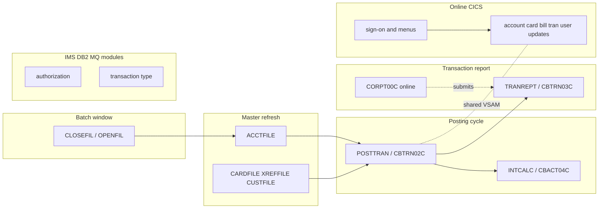

# 02 Coupling

The full edge list is in `02a-edge-tables.md`. This file is the argument. The target is refactor, and the three things that must not break are daily transaction posting, the account and card master refresh, and the transaction report.

## The patterns that constrain the sequence

| Pattern | What it does to the sequence | Confidence | Evidence |
|---|---|---|---|
| Five VSAM masters are shared by batch and online programs | The account master has 4 writers and 11 readers, and the transaction master has 3 writers and 11 readers. Batch posting and online screens write the same files, so batch and online cannot be cut into separate services before the files have one owner. | high | `modernization-assessment/graph.json:28699`, `modernization-assessment/graph.json:28705`, `app/cbl/CBTRN02C.cbl:547` |
| The refresh jobs rebuild a master, and the posting wrapper runs a rebuild in front of posting | `run_posting.sh` submits ACCTFILE, TCATBALF and TRANBKP before POSTTRAN. ACCTFILE deletes and redefines the account VSAM file, then reloads it from the flat file `ACCTDATA.PS`. CBTRN02C then adds each posted amount to the account balance. A balance is therefore only as good as the flat file that was loaded just before the run. | high | `scripts/run_posting.sh:17`, `scripts/run_posting.sh:26`, `app/jcl/ACCTFILE.jcl:25`, `app/jcl/ACCTFILE.jcl:61`, `app/cbl/CBTRN02C.cbl:547` |
| Undocumented record layouts are the only interface between writers and readers | 62 contract edges, all rated high because both sides COPY the same layout copybook. The extractor does not read DCB, LRECL or RECFM, so high means a shared layout, not proven equal. The report job sorts the transaction file by byte offset (card number at 263, date at 305) with no copybook at all. | medium | `app/jcl/TRANREPT.jcl:41`, `app/jcl/TRANREPT.jcl:42`, `app/cbl/CBTRN03C.cbl:51` |
| Ordering lives in shell wrappers, not in a scheduler | Of the ordering edges between jobs, those from the wrapper scripts are all medium, because they are the order of submits in a file. Only the Control-M folders give high-confidence conditions, and Control-M covers backup, interest and weekly refresh, not the posting job. The daily posting cycle is a shell script that sleeps for 5 or 10 seconds between submits. | medium | `scripts/run_posting.sh:14`, `scripts/run_posting.sh:27`, `app/scheduler/CardDemo.controlm:5` |
| The online report screen writes and submits JCL at run time | CORPT00C builds the report JCL line by line in working storage, with the date range in an in-stream SYMNAMES card, and submits it. The batch job TRANREPT has the dates hard-coded. There are two ways to produce the same report, and no edge joins them. | high | `app/cbl/CORPT00C.cbl:94`, `app/jcl/TRANREPT.jcl:43`, `app/jcl/TRANREPT.jcl:44` |

## Clusters

The edges in the diagram are the order in `scripts/run_posting.sh` (`scripts/run_posting.sh:13`, `scripts/run_posting.sh:17`, `scripts/run_posting.sh:26`), the report submit at `app/cbl/CORPT00C.cbl:94`, and the shared files at `modernization-assessment/graph.json:28699`. The Online-to-Posting link is a dotted line because it is a data coupling, not a call. The diagram is inference at the cluster level.

## Strongly connected components

They move as a unit, and the wave plan does not split them.

| Component | Why it is a cycle | Wave | Evidence |
|---|---|---|---|
| COSGN00C, COMEN01C, COADM01C | Sign-on, main menu and admin menu call each other. COSGN00C and COMEN01C each have 12 callers. | 3 | `app/cbl/COMEN01C.cbl:156`, `app/cbl/COADM01C.cbl:145` |
| COTRN00C, COTRN01C | Transaction list and transaction view call each other. Both are god modules. | 3 | `app/cbl/COTRN00C.cbl:192`, `app/cbl/COTRN01C.cbl:205` |
| COPAUS0C, COPAUS1C | Authorization summary and detail. COPAUS0C also calls itself. | 9 | `app/app-authorization-ims-db2-mq/cbl/COPAUS0C.cbl:322`, `app/app-authorization-ims-db2-mq/cbl/COPAUS1C.cbl:367` |

## God modules

COPAUS0C, COTRN00C and COTRN01C are the top decile for fan-in and fan-out (analysis field `god_modules`). None of the three is a must-not-break item. They are strangled behind a facade, and the transaction pair is in wave 3 only because it writes nothing. A facade at the screen boundary is the way to move it. A wholesale port is not (inference).

## Articulation points

The cut points computed over call edges plus program-to-dataset edges (analysis field `articulation_points`) that matter here are these.

| Point | Why it is a wave boundary | Evidence |
|---|---|---|
| CBTRN02C | Daily posting. Everything the posting cycle writes passes through it. It is the boundary between wave 6 increments (a) and (b). | `app/cbl/CBTRN02C.cbl:51` |
| CBTRN03C | Transaction report program. Boundary between increments (b) and (c). | `app/cbl/CBTRN03C.cbl:51` |
| CBACT04C | Interest calculation. It writes the account and category-balance files that posting also writes. | `app/cbl/CBACT04C.cbl:41` |
| ACCTDATA, CARDDATA, CARDXREF and CUSTDATA VSAM files | The master datasets. A file that is an articulation point has one owner in the target, whatever the plan does. | `modernization-assessment/graph.json:28690` |
| CBEXPORT and CBIMPORT | The export file is the only hand-off between them and is the one external boundary in the tree. | `app/cbl/CBEXPORT.cbl:65`, `app/cbl/CBIMPORT.cbl:37` |

## The honest boundary

- **28 computed calls** in 20 online programs and the authorization and transaction-type modules could not be resolved (`unresolved_dynamic`). Examples: `app/cbl/COACTUPC.cbl:956`, `app/cbl/COMEN01C.cbl:156`, `app/cbl/CORPT00C.cbl:548`. The pattern is a menu or a screen that transfers to a program name held in a field. It most likely is the pseudo-conversational CICS XCTL idiom (inference). I did not hand them to the dependency-cartographer agent: the count is over the 20 the skill sets, but all of them sit in online programs outside the three must-not-break flows, apart from CORPT00C at `app/cbl/CORPT00C.cbl:548`. Reading these 28 call sites is the first action for wave 3.
- **CBTRN01C** is not run by any JCL step and 28 computed calls could reach it, so it stays unknown. See `05-dead-code.md`.
- **Embedded JCL.** CORPT00C submits `proc:TRANREPT` from a COBOL literal (`app/cbl/CORPT00C.cbl:94`). The extractor notices it but makes no edge.
- **Not parsed.** The CA-7 scheduler listing `app/scheduler/CardDemo.ca7` is not read, so the 35 jobs listed as unscheduled may be scheduled there. Assembler (`app/asm/COBDATFT.asm`), IMS DBD and PSB, DB2 DDL and DCLGEN, and control cards are also not read (`modernization-assessment/graph.json:27433`).
- **Not modeled.** IF/THEN/ELSE and COND= in JCL, nested procs, CICS RETURN TRANSID and SEND MAP are not edges (`modernization-assessment/graph.json:16`, `modernization-assessment/graph.json:17`, `modernization-assessment/graph.json:18`). The screen flow between online programs is therefore under-counted.
