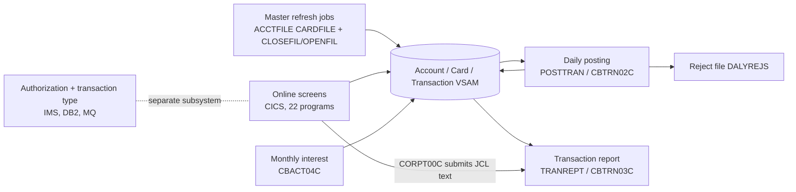

# 02 Coupling

Facts are in `02a-edge-tables.md`. This file is the argument. Target state: refactor. Must not break: daily transaction posting, the account and card master refresh, and the transaction report.

## Mapping the must-not-break items to units

| Item | Units | Evidence | Confidence |
|---|---|---|---|
| Daily transaction posting | `job:POSTTRAN` runs `CBTRN02C`; it opens the transaction, account and category-balance VSAM files | `app/jcl/POSTTRAN.jcl:23` | high |
| Account and card master refresh | `job:ACCTFILE`, `job:CARDFILE` (IDCAMS delete, define, REPRO), bracketed by `job:CLOSEFIL` and `job:OPENFIL`; `scripts/remote_refresh.sh` runs all ten refresh jobs | `app/jcl/ACCTFILE.jcl:22`, `app/jcl/CARDFILE.jcl:33`, `scripts/remote_refresh.sh:17` | medium. The phrase "refresh" is the client's; `CBACT04C` (interest) also rewrites account balances and may be meant. See Open Questions |
| Transaction report | `job:TRANREPT` and `proc:TRANREPT` run `CBTRN03C`; online `CORPT00C` submits the same proc from JCL text inside a COBOL literal | `app/jcl/TRANREPT.jcl:59`, `app/proc/TRANREPT.prc:57`, `app/cbl/CORPT00C.cbl:94` | high |

## The three patterns that constrain the sequence

### 1. Batch and online share the VSAM masters directly (data and contract coupling)

`CBTRN02C` and the online account, card and transaction programs read and write the same KSDS files. The posting job writes the transaction master (`ds:AWS.M2.CARDDEMO.TRANSACT.VSAM.KSDS`) and the account master (`ds:AWS.M2.CARDDEMO.ACCTDATA.VSAM.KSDS`). They are the two biggest data hubs: 4 writers and 11 readers for accounts, 3 writers and 11 readers for transactions (`analysis` field `data_hubs`). The contract edges around `CBTRN02C` are all `high`, because both sides COPY the same layout (`02a-edge-tables.md:31`). `high` means shared layout, not proven equal (`meta.limits`).

Consequence: posting cannot move to a new store alone. Either the online programs that read the same files move with it, or a bridge keeps both views of the data consistent. The refresh jobs make this worse. They delete and redefine the account master (`app/jcl/ACCTFILE.jcl:22`), so a ported posting job that holds a copy of the data would go stale at every refresh.

### 2. The transaction report is reachable two ways, one of them invisible to a call graph (embedded JCL)

The batch report is `job:TRANREPT` (`app/jcl/TRANREPT.jcl:23`). The online path is `CORPT00C`, which builds a job as COBOL literals and submits it (`app/cbl/CORPT00C.cbl:94`). The extractor logged this as `embedded_jcl` (`analysis` field `embedded_jcl`) and put `proc:TRANREPT` in the unknown dead-code bucket. Any port has to replace the submit mechanism and keep the date parameters the online screen passes. The proc hard-codes 2022-01-01 to 2022-07-06 (`app/proc/TRANREPT.prc:41`), and `CORPT00C` overrides them. That is inference from the cartographer's reading; the override is not in the graph.

The report's SORT step selects fields by byte offset (card number at 263, processing date at 305). The offsets match `CVTRA05Y` (`app/cpy/CVTRA05Y.cpy:5`), but the extractor does not read SORT cards (`meta.limits`). That is a `medium`-equivalent contract that a port breaks silently if the copybook is reshaped. Flagged as inference.

### 3. Ordering lives in shell scripts, and it is weaker than it looks (temporal coupling)

The run order for posting is a list of FTP `put` commands with `sleep` between some of them (`scripts/run_posting.sh:17`). Nothing waits for a job to finish. `ACCTFILE`, `TCATBALF`, `TRANBKP` and `POSTTRAN` are submitted back to back with no sleep (`scripts/run_posting.sh:20`). If the shop has more than one initiator in that class they can overlap. This is inference; the initiator configuration is not in the tree. The Control-M file defines the same bracket (CLOSEFIL, TRANBKP, WAITSTEP, OPENFIL) but not `POSTTRAN` (`app/scheduler/CardDemo.controlm:4`). The CA-7 listing does name `POSTTRAN` (`app/scheduler/CardDemo.ca7:78`) but the extractor cannot parse it (`NOT PARSED app/scheduler/CardDemo.ca7`). So there are three sources of truth for the order, and they disagree. Which one is production is an open question.

The Control-M jobs delete their own conditions after use (`app/scheduler/CardDemo.controlm:10`). The extractor does not turn that into an edge, so the order it reports for those folders is a lower bound.

## Cluster-level view

## Strongly connected components

They move whole or not at all (`analysis` field `sccs`).

| Component | Why | Evidence | Confidence |
|---|---|---|---|
| `COADM01C`, `COMEN01C`, `COSGN00C` | Sign-on and the two menus transfer control to each other | `app/cbl/COMEN01C.cbl:201`, `app/cbl/COADM01C.cbl:168` | high |
| `COTRN00C`, `COTRN01C` | Transaction list and detail screens call each other | `app/cbl/COTRN00C.cbl:192`, `app/cbl/COTRN01C.cbl:205` | high |
| `COPAUS0C`, `COPAUS1C` | Authorization summary and detail screens | `app/app-authorization-ims-db2-mq/cbl/COPAUS0C.cbl:322`, `app/app-authorization-ims-db2-mq/cbl/COPAUS1C.cbl:367` | high |

## God modules

`COPAUS0C`, `COTRN00C` and `COTRN01C` are flagged (`analysis` field `god_modules`). None sits on a must-not-break path. They are strangled behind a facade, never ported whole. `COACTUPC` is the largest program at 3,368 lines (`app/cbl/COACTUPC.cbl:1`). The extractor did not flag it as a god module, but it is the account update screen and it writes the account master, so it is the heaviest single port on the data side.

## Articulation points (natural boundaries)

`CBTRN02C`, `CBTRN03C`, `CBACT04C`, `CBSTM03A`, `CBEXPORT`, `CBIMPORT` and the account, card, customer and cross-reference KSDS datasets (`analysis` field `articulation_points`). The posting program is itself an articulation point, which is the good news: the posting boundary is a real seam, and the dataset layouts on either side are where an equivalence check attaches.

## The honest boundary

- 28 computed calls (`analysis` field `unresolved_dynamic`). The cartographer read all of them. Every value that can reach the target field is a literal, the caller's own name, or a row of a literal menu table (`app/cpy/COMEN02Y.cpy:1`, `app/cpy/COADM02Y.cpy:1`). None can reach `CBTRN01C`. This is inference from reading, labelled `high` for the set of targets. It is not a proof: the extractor does not model control flow.
- `CBTRN01C` is named by nothing in this tree (`app/cbl/CBTRN01C.cbl:1`). Treat it as unreferenced here, but it stays in the unknown bucket because an operator or an external scheduler outside the tree could run it.
- The CA-7 listing cannot be parsed. Every job in it carries the same run count and last-run stamp (`app/scheduler/CardDemo.ca7:24`), which looks templated, so it is not evidence of what ran.
- Eight file types are not read: DB2 DCLGEN and DDL, IMS DBD and PSB, control cards, assembler source and macros. Two assembler modules sit next to the date and wait routines (`app/asm/COBDATFT.asm:1`). `CSUTLDTC`, which sits in the posting wave, may depend on them. Unverified.
